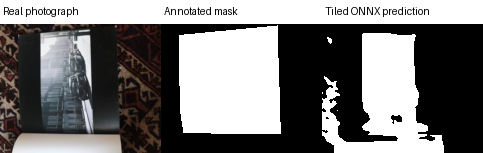

# Real document photographs: compile, train, export and tile

This example uses actual document photographs and manually annotated masks from
[pynicolas's FairScan dataset](https://github.com/pynicolas/fairscan-dataset),
release v1.0. The dataset and its resized images, masks and visualizations here
are **CC BY-NC-SA 4.0 (noncommercial, attribution, share alike)**. See the
[copied license](../examples/fairscan-data/LICENSE.txt) and
[source manifest](../examples/fairscan-data/manifest.json). The saved trained
weights and predictions are also provided under those terms. This is an
integration experiment, not a production document scanner or a new architecture.

## Launch the saved real-image demo

Provision the CPU PyTorch environment from the main README, then install the
compiler and validation dependencies. Pillow is only needed for data preparation,
training, replay and rendering; standalone tiled deployment needs NumPy and ONNX
Runtime only.

```sh
.venv/bin/python -m pip install -r requirements-fairscan.txt
.venv/bin/python -m pip install --no-deps --no-build-isolation -e .
.venv/bin/python -m unet_budget examples/fairscan-v2.json --out /tmp/fairscan-compiled
.venv/bin/python -m unet_budget export examples/fairscan-v2.json \
  --checkpoint results/fairscan/weights.pt --shape 1 3 65 81 --out /tmp/fairscan-bundle
.venv/bin/python src/unet_budget/onnx_tiled.py /tmp/fairscan-bundle \
  results/fairscan/input.npy --output /tmp/fairscan-logits.npy \
  --overlap 32 40 --blend gaussian --threads 1
```

Use new `/tmp` paths on subsequent launches: the commands intentionally reject
existing outputs. The specification selects width 8 (29,770 parameters), the
largest candidate within 32,000 parameters. The saved input is the first validation photograph, resized to
**129×161**, larger than the fixed **65×81** model input on both axes. Nine tiles
produce raw `[1, 2, 129, 161]` logits; argmax over channel axis 1 gives the mask.
The checkpoint, checked export, input, target, output and image-and-mask preview
are committed, so this launch requires no data downloads or training.



This preview always uses the first validation image in lexical order; it is not
selected for visual quality. The metrics cover all eight validation images.
To deploy without the project, copy `src/unet_budget/onnx_tiled.py`,
`results/fairscan/input.npy` and `results/fairscan/bundle/` to a runtime-only
environment. Follow the [standalone deployment instructions](onnx-tiled.md).

## Reproduce the experiment

```sh
# Verify Gaussian deployment and reproduce all 24 cases, including one known failure.
# No training, downloads or mutation of saved results.
.venv/bin/python scripts/verify_fairscan.py
.venv/bin/python scripts/verify_fairscan_launch.py

# Train the fixed second recipe from scratch into a new directory.
.venv/bin/python experiments/fairscan.py --output /tmp/fairscan-retrained
```

The verifier is a regression for the recorded CPU/dependency environment: it requires
exact saved numerical statistics in addition to the tolerance checks. It may
reject another provider/CPU/version that still satisfies runtime tolerances.
Measured timing values are never required to match and are never overwritten by
the check. The [results JSON](../results/fairscan/results.json) records raw timing
samples, training losses, dependencies, protocol/source/data hashes and artifact
hashes. Export provenance includes the checkpoint hash, generated source and
architecture, fixed shapes and dependency versions.

The Gaussian deployment passes all eight images. One additional constant,
no-overlap case fails its elementwise tolerance. The original strict experiment
therefore exits 1 **after saving its results**, including when retrained with the
recorded recipe. To reproduce that strict failure explicitly:

```sh
.venv/bin/python scripts/verify_fairscan.py --strict-all
```

The separate deployment verifier was added after observing the failure. It
reproduces all saved cases exactly, requires the same single failure identity,
and requires all eight Gaussian cases to pass. It does not change thresholds or
erase the strict experiment's failure. Delivery covers the documented overlapping
Gaussian workflow; universal parity across inference settings is not established.

All 32 resized image/mask pairs are bundled (about 1 MiB). To reconstruct them
from the public archive, use a new output directory:

```sh
curl -fL https://github.com/pynicolas/fairscan-dataset/releases/download/v1.0/document-segmentation-dataset-v1.0.zip \
  -o /tmp/fairscan-v1.zip
.venv/bin/python experiments/prepare_fairscan.py /tmp/fairscan-v1.zip \
  --output /tmp/fairscan-data
```

The preparation script checks the archive SHA-256 before extraction. It selects
the first 24 training and first 8 validation JPEG paths in lexical order from
the upstream split. It records original archive paths, dimensions and hashes,
then resizes RGB images to 161×129 with Pillow bilinear interpolation and masks
with nearest-neighbor interpolation. It does not preserve aspect ratio or apply
EXIF rotation. Input is RGB float32 divided by 255; masks use values greater than
zero as foreground. No threshold-derived or synthetic training labels are used.

The [second frozen recipe](../experiments/fairscan_v2_protocol.json) trains 100
epochs of four uniformly sampled 65×81 crops per training image per epoch, with
batch size 8, Adam at 0.001, weight seed 303 and crop/shuffle seed 404. The compiler
selects width 8. Evaluation never updates weights; the last epoch is used without
early stopping or checkpoint selection. Training and validation source image
hashes are disjoint. Photographs may show related scenes/documents, and the
upstream split is not an independently audited subject-level split.

## What is measured

Each of the eight validation images is evaluated with no-overlap constant,
overlapping constant and overlapping Gaussian blending in both ONNX and PyTorch.
Both runtimes use the same checkpoint, tiles, traversal, zero padding and float32
logit accumulation. Overlap is 32×40. Starts are rows `[0, 33, 66]` and columns
`[0, 41, 82]`; bottom/right tiles extend by two pixels and are cropped back to
129×161. The existing [independent geometric oracle](../tests/test_onnx_tiled.py)
tests coverage, padding, blending and boundaries on 256 geometries, including
smaller-than-tile images and near-total overlap.

All bounds were fixed before the first real-data run and retained for the second:
`abs(ONNX - Torch) <= 1e-5 + 1e-5*abs(Torch)` for every logit, maximum absolute error
at most `1e-4`, mean absolute error at most `1e-5`, label disagreement at most
`0.001`. Failed comparisons are saved before a nonzero exit. Task Dice/IoU/accuracy
are separate from runtime parity and are compared to both all-background and
all-foreground baselines. Whole-image PyTorch inference is measured separately;
tiled inference does **not** generally equal whole-image inference.

CPU latency measures the complete inference APIs on the first real validation
image with two warmups and seven timed calls each, alternating runtime order in
one process. It includes validation, tile construction, prediction, blending and
normalization; it excludes imports, model/session setup, file IO, image decoding
and rendering. Both runtimes use one intra-op and inter-op thread. Raw samples
are retained. These are shared-host, small-sample measurements, not deployment
speed guarantees or isolated memory measurements. Historical synthetic timing
and the known fixed-shape ONNX tolerance failure remain in their original reports.

The recorded second run gives these pooled pixel-level results (not per-image
means or confidence intervals):

| Prediction | Foreground Dice | Foreground IoU | Pixel accuracy |
| --- | ---: | ---: | ---: |
| All background | 0 | 0 | 0.621467 |
| All foreground | 0.549182 | 0.378533 | 0.378533 |
| Gaussian tiled ONNX | 0.648309 | 0.479628 | 0.664927 |
| Whole-image PyTorch | 0.652094 | 0.483783 | 0.669814 |

The Gaussian result has zero ONNX/PyTorch label disagreements across all eight
images, maximum absolute logit error `9.41754e-6`, and worst elementwise error
`0.783308` times its bound. All eight overlapping-constant cases also pass.
Median latency on the first image was **71.596 ms PyTorch / 31.507 ms ONNX**.
The 1,200 training steps took 177.829 seconds. The
[host snapshot](../results/fairscan-host.json) records CPU model, affinity, quota
and runtime builds, captured immediately after both runs.

The one failure is validation image `IMG_20250614_210835`, constant blending,
no overlap: maximum absolute error `1.15037e-5`, mean `2.72823e-7`, and worst
elementwise error `1.057427` times its bound, with zero label disagreement.
The [diagnostic](../results/fairscan-numerical-investigation.json) retains the
default failure and compares against float64 PyTorch. Disabling ONNX graph
optimizations passes this one case, suggesting sensitivity to numerical execution
paths; this does not identify a particular kernel or establish a general fix.
Default runtime settings remain unchanged. Reproduce the diagnostic with
`.venv/bin/python experiments/investigate_fairscan.py --check`.

## Negative result and limits

The [first recipe](../experiments/fairscan_protocol.json) used a 8,000-parameter
budget (7,542 selected), Adam at 0.003 and 30 epochs. Training plateaued and the
validation prediction collapsed to all foreground: Dice 0.549182, IoU/accuracy
0.378533, versus all-background accuracy 0.621467. Its
[complete result](../results/fairscan-initial/results.json), checkpoint, exported
model, prediction, demo and exact experiment-source snapshot remain available.
The first recipe's specification is [fairscan.json](../examples/fairscan.json).
Runtime parity passed despite useless segmentation, illustrating why parity is
not task quality. The original script hash in that result corresponds to
`results/fairscan-initial/experiment-source.txt`.

The second recipe was chosen after observing that failure: a larger budget,
lower learning rate and longer training. Validation was therefore reused; this
is not an untouched test set, unbiased model comparison or generalization claim.
There are only 24 training images, eight validation images and one training seed.
No medical application, production scanning quality or robust document detection
is established.

Supported abstractions remain the narrow compiler family in the main README:
2D dense U-Net, integer candidate-width parameter budget, biased convolutions,
ReLU, max pooling and nearest-neighbor skip resizing. No arbitrary natural-language
architecture, pretrained encoder, attention, normalization, arbitrary task/loss,
3D model, quantization, GPU runtime or dynamic-shape ONNX support is provided.
Tiled deployment supports batch-one float32 fixed-shape CPU bundles only. It does
not decode photographs or apply preprocessing itself. Overlap cannot restore
missing context; full-image input/output storage still grows with image size.
